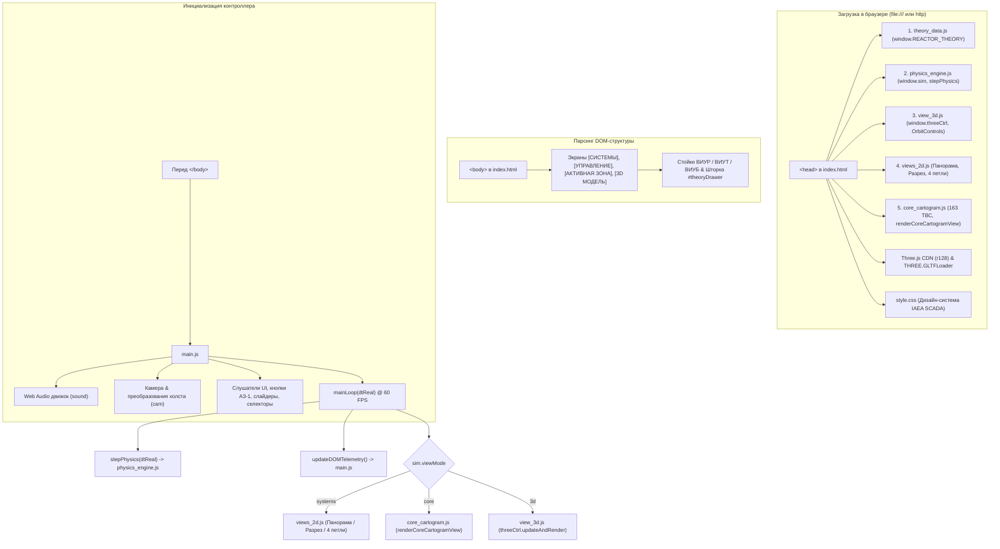

# ReactorLab // Архитектурная карта проекта (Цифровой двойник ВВЭР-1200 / В-491 БелАЭС)

> [!IMPORTANT]
> **РЕГЛАМЕНТ РАБОТЫ С PROJECT_MAP.md:**  
> `PROJECT_MAP.md` — это навигационный компас и свод жестких ограничений, а не пошаговый скрипт для каждого файла. Агент сверяется с ним на старте задачи (для проверки дизайн-кода и архитектуры) и обновляет статус чек-листа в конце задачи. Запрещено тратить контекст на бесконечное перечитывание всего документа при точечных правках кода.

> **Статус документа:** Официальный актуализированный архитектурный паспорт системы (Lead Systems Architect & Physics Engine Audit)  
> **Версия системы:** `v4.6.0-Enterprise` («Slate Light SCADA Palette & Autonomous Cleanup»)  
> **Дата синхронизации:** 5 ноября 2026 г.  
> **Чистая разметка UI:** [`index.html`](file:///c:/Users/User/Desktop/сайт%20атомной%20инженирии/index.html) (38 387 байт, 621 строка)  
> **Таблица стилей SCADA:** [`style.css`](file:///c:/Users/User/Desktop/сайт%20атомной%20инженирии/style.css) (41 091 байт, 1 730 строк)  
> **Академический модуль:** [`theory_data.js`](file:///c:/Users/User/Desktop/сайт%20атомной%20инженирии/theory_data.js) (24 509 байт, 281 строка)  
> **Физическое ядро:** [`physics_engine.js`](file:///c:/Users/User/Desktop/сайт%20атомной%20инженирии/physics_engine.js) (30 637 байт, 540 строк)  
> **3D WebGL / PBR модуль:** [`view_3d.js`](file:///c:/Users/User/Desktop/сайт%20атомной%20инженирии/view_3d.js) (66 833 байта, 1 592 строки)  
> **2D мнемосхемы систем:** [`views_2d.js`](file:///c:/Users/User/Desktop/сайт%20атомной%20инженирии/views_2d.js) (143 978 байт, 3 188 строк)  
> **Картограмма 163 ТВС:** [`core_cartogram.js`](file:///c:/Users/User/Desktop/сайт%20атомной%20инженирии/core_cartogram.js) (43 556 байт, 957 строк)  
> **Главный контроллер & UI:** [`main.js`](file:///c:/Users/User/Desktop/сайт%20атомной%20инженирии/main.js) (91 383 байта, 1 745 строк)  
> **Режим совместимости:** 100% классические скрипты без CORS-ограничений (автономная работа по протоколу `file:///`).

---

## 1. Обзор проекта и статус модульной декомпозиции

**ReactorLab** — это высокоточный интерактивный цифровой двойник и инженерный тренажер энергоблока АЭС с реакторной установкой **ВВЭР-1200 (проект В-491, БелАЭС / АЭС-2006, поколение III+)**. Проект сочетает визуальные стандарты SCADA-систем реального блочного щита управления (БЩУ) Белорусской АЭС, академическую строгость физических моделей (МИФИ, IAEA SSG-54, формуляция IAPWS-IF97) и интерактивную 3D-графику промышленного уровня на базе WebGL / Three.js.

### Ключевые вехи архитектуры (v4.0.0 — v4.4.0):
1. **Полная декомпозиция монолита `index.html`:** Исходный монолит размером 7 618 строк сокращен до **621 строки** чистой семантической HTML5-разметки (снижение объема на 92%).
2. **Экстернализация стилей (`style.css`):** 1 734 строки дизайн-системы IAEA SCADA вынесены в отдельную таблицу стилей.
3. **Академический базис (`theory_data.js`):** Независимый реестр `window.REACTOR_THEORY` с 12 математическими моделями кинетики, обратных связей, ксенона, теплогидравлики IAPWS-IF97 и библиографией МИФИ.
4. **Физико-математическое ядро (`physics_engine.js`):** Вынос состояния `sim`, точечной кинетики 6 групп запаздывающих нейтронов, температурных коэффициентов Доплера и замедлителя, кинетики ксенона-135 и алгоритмов АЗ-1/ПЗ.
5. **3D WebGL / PBR модуль (`view_3d.js`):** Автономный контроллер `threeCtrl` с PBR-ассетом корпуса `vver1200_rpv.glb`, трехточечным светом, выносными пинами и контроллером камеры `VVEROrbitControls`.
6. **2D-мнемосхемы технологических систем (`views_2d.js`):** Панорамная мнемосхема 1-го и 2-го контуров В-491, вертикальный разрез гермооболочки В-491, план 4 петель ГЦК и вспомогательные векторные примитивы.
7. **Картограмма зоны и паспорт кассеты (`core_cartogram.js`):** Геометрия 163 бесчехловых ТВС-2М, 121 привод СУЗ, LERP-градиент теплового поля СВРК, хит-тестинг и двухрежимный паспорт кассеты (Ознакомительный / Инженерный с 12 слоями $K_z$ и DNBR).
8. **Главный контроллер приложения (`main.js`):** Управление камерой canvas, аудио-движок Web Audio, переключение вкладок, панели БЩУ, сценарии, телеметрия DOM и 60 FPS цикл `mainLoop`.
9. **Изоляция графических ассетов и очистка репозитория Git (v4.1.0):** Все графические превью и скриншоты перемещены в каталог `docs/screenshots/` с полным исключением из Git-индекса (`git rm --cached`).
10. **Интеграция высокоточного GLB-ассета корпуса реактора и зачистка процедурки (v4.2.0):** Устаревшая процедурная геометрия корпуса, фланцев, крышки и хаотичных стоек (1 870 строк кода) полностью удалена из `view_3d.js`. Внедрен загрузчик `THREE.GLTFLoader`, выполнена бесшовная интеграция готового PBR-ассета `vver1200_rpv.glb` (высота 16.72 м, диаметр фланца ~2.75 м, сталь `#3b4252`, Metallic 0.85, Roughness 0.35). Настроено трехточечное освещение, адаптировано окружение, камера сфокусирована строго на геометрический центр реактора (0, 8.36, 0).
11. **Интеграция многокомпонентного ассета ВКУ и режимы X-Ray / Взрыв-схема (v4.3.0):** Интегрирован многокомпонентный ассет `vver1200_rpv.glb` (3.75 МБ) с 5 независимыми дочерними мешами (`RPV_Vessel`, `RPV_Core_Barrel`, `RPV_Core_Shroud`, `RPV_Core_Assemblies`, `RPV_BZT`). Реализованы режимы X-Ray и послойной взрыв-схемы с анимацией lerp.
12. **Переработка SCADA-мнемосхемы по нормативной документации БелАЭС В-491 (v4.4.0):** Модуль `views_2d.js` полностью пересобран в темно-графитовой теме SCADA (`#090e17`). Отрисован реактор В-491 (JEA) с графическим разделением шахты и активной зоны 3200 МВт; разведены 4 циркуляционные петли (Ду-850, 16.2 МПа) с ПГВ-1000МКП (JEB10..40) и ГЦНА-1391 (JEC10..40); на петле №4 реализован компенсатор давления 79 м³ (JEP10) со спреем, дыхательной линией, ТЭНами 2520 кВт, клапаном ИПУ КД и барботером (JEP30); добавлены гидроемкости САОЗ (JNB10..40) и насосы аварийного расхолаживания ВД/НД (JND/JNG). 2-й контур включает коллектор острого пара ГПК (LBA 7.0 МПа, 285.8 °C) со сбросом от БРУ-А/К, быстроходную турбину К-1200-6.8/50 (LMA), турбогенератор ТЗВ-1200-2 (MKA 1199.8 МВт), конденсаторы (MAG), конденсатные насосы (LAA), деаэратор 0.871 МПа (LAB) и питательные электронасосы ПЭН (LAB 225 °C) с замкнутым возвратом в 4 ПГ. Интегрированы бегущие маркеры расхода и термоградиенты.

---

## 2. Итоговое дерево модулей и физические метрики

```
c:\Users\User\Desktop\сайт атомной инженирии\
├── .gitignore                      # Исключения Git (node_modules, docs/screenshots/, *.png, *.old.js, *.backup.js)
├── PROJECT_MAP.md                  # [Настоящий документ] Генеральная архитектурная карта v4.5.0
├── index.html                      # [38 387 байт / 621 строка] Чистый UI-каркас и разметка БЩУ + Three.js & GLTFLoader
├── style.css                       # [41 091 байт / 1 730 строк] SCADA-стили, токены, компоненты
├── theory_data.js                  # [24 509 байт / 281 строка] Академический справочник и формулы (В-491 БелАЭС)
├── physics_engine.js               # [30 637 байт / 540 строк] Ядро кинетики и теплогидравлики (sim, stepPhysics)
├── view_3d.js                      # [66 833 байта / 1 592 строки] 3D WebGL / Three.js PBR модель (threeCtrl, 5 узлов ВКУ, X-Ray, Взрыв-схема)
├── views_2d.js                     # [143 978 байт / 3 188 строк] 2D мнемосхемы (Панорама, Разрез, 4 петли)
├── core_cartogram.js               # [43 556 байт / 957 строк] Картограмма 163 ТВС и паспорт кассеты
├── main.js                         # [91 383 байта / 1 745 строк] Диспетчер UI, звук, телеметрия, mainLoop
├── vver1200_rpv.glb                # [3 753 732 байта] Высокоточная 3D PBR-модель ВВЭР-1200 (5 независимых узлов ВКУ)
├── package.json                    # [59 байт / 6 строк] Манифест окружения Node.js (Playwright)
├── package-lock.json               # [1 142 байта / 42 строки] Фиксация зависимостей
└── docs/
    ├── blender/                    # Исходные файлы 3D-моделирования
    │   ├── VVER1200_RPV.blend      # [1 727 010 байт] Мастер-файл сцены Blender
    │   ├── VVER1200_RPV.blend1     # [1 730 328 байт] Автоматический бэкап Blender
    │   ├── vver1200_internals.py   # [10 521 байт] Генератор геометрии ВКУ
    │   └── vver1200_rpv.py         # [11 723 байта] Генератор геометрии корпуса реактора
    └── screenshots/                # [16 файлов, локальное хранение на диске, исключено из Git]
        ├── controls_preview.png        # [853 406 байт] Снимок 3 постов управления БЩУ
        ├── cross_preview.png           # [177 617 байт] Снимок 2D-разреза гермооболочки
        ├── drawer_preview.png          # [530 557 байт] Снимок открытой шторки теории
        ├── loops_preview.png           # [231 290 байт] Снимок схемы 4 петель ГЦК
        ├── preview.png                 # [249 625 байт] Финальный снимок главного экрана
        ├── preview_2d_panorama_pid.png # [321 132 байта] Снимок панорамной P&ID мнемосхемы (темная тема)
        ├── preview_2d_scada.png        # [298 179 байт] Снимок мнемосхемы SCADA
        ├── preview_3d_fixed.png        # [799 950 байт] Проверочный снимок 3D-сцены ВВЭР-1200
        ├── preview_3d_glb.png          # [391 665 байт] Снимок 3D GLB-модели ВВЭР-1200
        ├── preview_3d_new.png          # [388 398 байт] Снимок 3D PBR модуля с выносными пинами и карточкой
        ├── preview_3d_xray.png         # [342 243 байта] Снимок 3D-модели в режиме X-Ray
        ├── preview_core_engineering.png# [581 618 байт] Картограмма 163 ТВС (Инженерный режим)
        ├── preview_core_introductory.png# [551 343 байта] Картограмма 163 ТВС (Ознакомительный режим)
        ├── preview_engineering.png     # [555 514 байт] Снимок панорамы в инженерном режиме
        ├── preview_recovered.png       # [250 041 байт] Снимок экрана [СИСТЕМЫ]
        └── preview_theory_sources.png  # [525 466 байт] Снимок раздела первоисточников
```

### Сводная таблица ключевых модулей

| Файл модуля | Объем (байт) | Строк | Зона ответственности и публичные интерфейсы |
|---|---|---|---|
| [`index.html`](file:///c:/Users/User/Desktop/сайт%20атомной%20инженирии/index.html) | **38 387** | **621** | Семантическая разметка: `.topbar`, `.kpi-bar`, `#canvasContainer`, пульты ВИУР/ВИУТ/ВИУБ, `#threeToolbar` с кнопками X-Ray и взрыв-схемы. |
| [`style.css`](file:///c:/Users/User/Desktop/сайт%20атомной%20инженирии/style.css) | **41 091** | **1 730** | SCADA-стили IAEA: светлая тема, сетка `.iaea-shell`, панели приборов, карточка ТВС, 12 слоев $K_z$. |
| [`theory_data.js`](file:///c:/Users/User/Desktop/сайт%20атомной%20инженирии/theory_data.js) | **24 509** | **281** | Декларативный базис `window.REACTOR_THEORY`: формулы кинетики, Доплера, ксенона, теплогидравлики IAPWS, библиография МИФИ. |
| [`physics_engine.js`](file:///c:/Users/User/Desktop/сайт%20атомной%20инженирии/physics_engine.js) | **30 637** | **540** | Модель точечной кинетики, теплогидравлики, `window.sim`, `window.stepPhysics(dtReal)`, `triggerAZ1`, `resetPhysicsToNominal`. |
| [`view_3d.js`](file:///c:/Users/User/Desktop/сайт%20атомной%20инженирии/view_3d.js) | **66 833** | **1 592** | 3D WebGL PBR Digital Twin: `window.threeCtrl`, `window.vverModel` (5 узлов), `buildProceduralReactor` (fallback для file:///), `setXRay()`, `setExploded()`. |
| [`views_2d.js`](file:///c:/Users/User/Desktop/сайт%20атомной%20инженирии/views_2d.js) | **143 978** | **3 188** | Мнемосхемы P&ID: «Панорама» (Рис. 2.2.1, 50 узлов), «Разрез гермооболочки В-491» (10UJA и 10UMA), «4 петли ГЦК» (вектор 1.5–2px, изгибы 90°, темная тема). |
| [`core_cartogram.js`](file:///c:/Users/User/Desktop/сайт%20атомной%20инженирии/core_cartogram.js) | **43 556** | **957** | `window.coreAssemblies` (163 ТВС), `renderCoreCartogramView`, LERP-палитра $K_q$, 12 слоев $K_z$, DNBR, хит-тестинг. |
| [`main.js`](file:///c:/Users/User/Desktop/сайт%20атомной%20инженирии/main.js) | **91 383** | **1 745** | Диспетчер интерфейса, Web Audio (`sound`), камера (`cam`), телеметрия (`updateDOMTelemetry`), сценарии, `mainLoop`. |
| [`vver1200_rpv.glb`](file:///c:/Users/User/Desktop/сайт%20атомной%20инженирии/vver1200_rpv.glb) | **3 753 732** | — | Высокоточная 3D PBR-модель ВВЭР-1200 (5 независимых узлов ВКУ). |

---

## 3. Архитектурная топология и порядок загрузки модулей



---

## 4. Контракты интерфейсов и публичные API модулей

### 4.1. Модуль физики `physics_engine.js`
- `window.sim` — реактивный объект состояния энергоблока (мощность, давления, температуры, группы СУЗ, борная кислота, контуры, аварии).
- `window.NUCLEAR_CONSTANTS` — фундаментальные ядерные константы ($\beta_{\text{eff}}, \lambda_i, \sigma_{Xe}, \gamma_I, \gamma_{Xe}, \alpha_D, \alpha_M$).
- `window.stepPhysics(dtReal)` — расчет шага дифференциальных уравнений кинетики точечного реактора и теплогидравлики IAPWS-IF97.
- `window.triggerAZ1(reason)` — алгоритм аварийного сброса 121 стержня СУЗ ($< 4$ с).
- `window.resetPhysicsToNominal()` — сброс РУ к номинальному стационарному состоянию (3200 МВт, 16.2 МПа).

### 4.2. Модуль 3D-графики `view_3d.js`
- `window.threeCtrl` — синглтон 3D WebGL сцены (PBR-реактор В-491, освещение, выносные пины, HUD-зум).
- `window.vverModel` — структурированный реестр 5 узлов модели ВВЭР-1200:
  - `root`: корневой узел `gltf.scene`
  - `vessel`: корпус `RPV_Vessel` со сквозными патрубками Ду-850 (4 горячих / 4 холодных)
  - `barrel`: внутрикорпусная шахта `RPV_Core_Barrel`
  - `shroud`: выгородка активной зоны `RPV_Core_Shroud`
  - `core`: монолитный массив 163 ТВС-2М `RPV_Core_Assemblies` (золотистый цирконий)
  - `bzt`: блок защитных труб `RPV_BZT` с чехлами приводов СУЗ
- `window.threeCtrl.setXRay(enabled)` / `toggleXRay()` — управление режимом рентгена корпуса (полупрозрачный синевато-стальной материал, `opacity = 0.25`, `depthWrite = false`, `renderOrder = 2`).
- `window.threeCtrl.setExploded(progress)` / `toggleExploded()` — послойная взрыв-схема со смещением по оси $Y$ (шахта $+4.0$ м, выгородка $+6.0$ м, активная зона $+8.0$ м, БЗТ $+12.0$ м) и lerp-анимацией в цикле `render()`.
- `window.threeCtrl.ensureInitialized()` / `resize()` / `updateAndRender(dtReal)`.
- `window.VVEROrbitControls` — орбитальный контроллер камеры с кинематическим сглаживанием.
- `window.VVER_SPECS` — пространственные координаты и спецификации технологических узлов В-491 (включая ВКУ).

### 4.3. Модуль 2D-мнемосхем `views_2d.js`
- `window.renderPanoramicSystemsView()` / `window.renderPanoramic()` — аутентичная векторная принципиальная технологическая схема энергоблока ВВЭР-1200 (Рис. 2.2.1) в стандарте P&ID (ISO 10628 / ГОСТ 2.784):
  - **Стиль**: фон `#090e17`, тонкие контрастные технологические линии 1.5–2.0 px, строго ортогональные изгибы 90°, полное отсутствие дашбордных серых плашек и карточек.
  - **Стандартные инженерные символы**: клапаны "песочные часы" / бабочки (⋈) с электроприводами (M), обратными тарелками, мембранами и защитными клапанами; насосы — окружности со стрелкой направления потока и динамической анимацией ротора; баки и емкости — сосуды с физическим заполнением уровня жидкости.
  - **Топология Рис. 2.2.1**:
    - *Здание реактора 10UJA*: двойной купол гермооболочки (6, 7) с кольцевым зазором, венттрубой (25), фильтрами (24) и вентустановкой (23); СПОТ ГО (28, 29); спринклерный коллектор (17); пассивные рекомбинаторы (18); реактор В-491 (1) с ШЭМ-3, шахтой, выгородкой, активной зоной 163 ТВС-2М; ловушка расплава УЛР (20) с охлаждающим змеевиком; гидроемкости САОЗ (5); петли 1-го контура Ду-850 с ПГВ-1000МКП (2) слева и справа, ГЦНА-1391 (3); компенсатор давления КД 79 м³ (4) с дыханием, спреем, ТЭНами и сбросом ИПУ в барботер (19); бак-приямок (8); аварийные насосы САОЗ НД (11) и ВД (12); баки бора (13, 14), химреагентов (15, 16), щелочи (21), обессоленной воды (26, 27) и брызгальный бассейн (34).
    - *Машинный зал 10UMA*: паропроводы острого пара через гермопроходки к блоку ГПАБ (22) с БЗОК и БРУ-А; цилиндр высокого давления ЦВД (45) с СК/РК; СПП-1200 / ПП (46); 3 цилиндра низкого давления ЦНД-1..3 (45); турбогенератор ТЗВ-1200-2 (47) с выходом в энергосистему (50); конденсаторы (42) со сбросом БРУ-К; конденсатные насосы КЭН-1 (38); фильтры БОУ (41); КЭН-2 (39); каскад ПНД 1..4 (37); деаэратор 0.871 МПа (35); питательные насосы ПЭН (48) и АПЭН (49); каскад ПВД 5..7 (36); напорный тракт питательной воды 225 °C обратно в ПГ; гиперболоидная градирня (40) с дождевальным слоем и парящим факелом; циркуляционные насосы ЦН (43) и вспомогательные охладители (44).
  - **Динамика и интеграция**: привязка уровней, давлений, температур к `window.sim`, динамические бегущие маркеры расхода, интерактивные хотспоты с управлением арматурой и насосами.
- `window.renderCrossSectionView()` — вертикальный разрез строго здания реактора и двойной защитной гермооболочки `10UJA` (В-491) ровно по центру холста (высота 85% Canvas, без машинного зала): высотные отметки (`0.000`, `+13.200`, `+26.300`, `+65.000`), шахта реактора и опорная ферма по центру, конус УЛР (Кориум-кетчер) под днищем, корпус ВВЭР-1200 с верхним блоком ШЭМ-3 и патрубками Ду-850, бассейн выдержки топлива (БВ) слева от шахты, бетонные боксы парогенераторов ПГВ-1000МКП и ГЦНА-1391 по бокам, 4 гидроемкости САОЗ 1-й очереди на отметке `+26.300`, круговой полярный кран под куполом и спринклерные коллекторы распыления раствора бора под сводом.
- `window.roundRect(ctx, x, y, w, h, r)` — базовый графический примитив со скруглением.

---

## 4.6. СТРОГИЙ ДИЗАЙН-КОД: СТАНДАРТ «SLATE LIGHT SCADA»

Агент обязан строго следовать данной эталонной цветовой палитре («Slate Light SCADA») и графическим правилам во всех последующих генерациях без самовольных изменений:

- **Фон подложки приложения (`--bg-main`):** `#F1F5F9` (мягкий холодный сланец);
- **Карточки, холсты и рабочие блоки (`--bg-panel`):** `#FFFFFF`, контур `border: 1px solid #E2E8F0` (`--border-subtle`);
- **Основной текст и заголовки (`--text-main`):** `#0F172A` (глубокий контрастный сланец);
- **Вторичные метки, размерности, сетка Canvas (`--text-muted`):** `#64748B`;
- **Главный технологический акцент (`--accent-primary` / `--cyan`):** `#0284C7` (кобальтовый);
- **Инженерная температурная шкала теплоносителя (`THERMAL_COLOR_SCALE`):**
  - *Холодная вода / охлаждение (10°C – 45°C):* `#0EA5E9` (Ледяной лазурный) — водозабор, градирни, подпитка;
  - *Возвратный контур (45°C – 100°C):* `#06B6D4` (Глубокий циан) — конденсат, возврат охлажденной воды;
  - *Горячая вода / пар (100°C – 280°C):* `#F59E0B` (Янтарный) — 2-й контур, паропроводы от ПГ к турбине, питательная вода высокого давления;
  - *Активная зона реактора (280°C – 330°C):* `#EF4444` (Сигнальный коралловый) — 1-й контур под давлением, корпус реактора, горячие и холодные нитки ГЦТ;
  - *Критический перегрев (> 350°C):* `#DC2626` (Глубокий кармин) — аварийные уставки и перегрев ТВЭЛ;
- **Конструкции и оборудование на холсте P&ID (`views_2d.js`):**
  - *Фон холста:* бесшовный `#FFFFFF` (полный отказ от черных рамок `#080D14` / `#0B0F17`);
  - *Строительные конструкции (купол, шахта, фундамент):* четкие линии `1.5px` цветом `#334155` / `#475569`;
  - *Корпус реактора, ПГ, деаэратор, турбина:* подложка узлов `#F8FAFC` с обводкой `#1E293B`;
  - *Текстовые подписи оборудования (KKS-коды, отметки):* высококонтрастный `#0F172A`;
  - *Статусы:* авария `#DC2626`, норма `#16A34A`, отключено `#64748B`;
- **Запрещены:** черные прямоугольники на светлом фоне, градиентные серые плашки дашбордов, кислотные неоновые блики, разнобой толщины линий.

### 4.4. Модуль картограммы зоны `core_cartogram.js`
- `window.coreAssemblies` — массив 163 ТВС-2М с координатами $(q, r)$, обогащением, выгоранием, номером группы ОР СУЗ.
- `window.renderCoreCartogramView()` — рендеринг картограммы активной зоны и интерактивного паспорта кассеты.
- `window.hitTestCoreAssembly(wx, wy)` / `window.selectCoreAssembly(id)` — методы выбора ТВС.
- `window.coreHeatColor(kq)` / `coreHeatTextColor(kq)` — функции LERP-градиента тепловыделения.

### 4.5. Главный модуль `main.js`
- `window.sound` — процедурный звуковой движок (гул ГЦНА, шум пара, сирена АЗ-1).
- `window.cam` — координаты панорамирования и масштаб холста мнемосхем.
- `window.updateDOMTelemetry()` — синхронизация значений приборов, индикаторов и графиков БЩУ.
- `window.applyScenario(key)` — переключение между технологическими сценариями.
- `window.mainLoop(now)` — 60 FPS цикл `requestAnimationFrame`.

---

## 5. Результаты аудита инженерного базиса (`theory_data.js`)

Проведен глубокий парсинг и структурно-смысловой аудит академического модуля:
1. **Реестр первоисточников и внешних URL:**
   - База содержит 5 ключевых источников:
     - Дементьев Б. А. («Ядерные энергетические реакторы», МИФИ, 1990) — библиографическое описание.
     - Овчинников Ф. Я., Семенов В. В. («Эксплуатационные режимы ВВЭР», 1988) — библиографическое описание.
     - Концерн «Росэнергоатом» / Нововоронежская АЭС-2 (Технологический регламент В-392М) — эксплуатационная документация.
     - IAEA Safety Standards SSG-54 («Design of the Reactor Core for NPPs», Вена, 2019) — международный регламент.
     - Видеоматериалы УТЦ АЭС / БЩУ — внешняя ссылка `https://www.rosatom.ru/about-nuclear-industry/` (валидный рабочий URL).
2. **Структура разделов и математический аппарат (12 формул):**
   - **Раздел 1: Точечная кинетика (6 групп):**
     1. $dn(t)/dt = [(\rho(t) - \beta_{\text{eff}})/\Lambda] \cdot n(t) + \sum \lambda_i C_i(t) + S_{\text{ext}}$ (генерация мгновенных и запаздывающих нейтронов);
     2. $dC_i(t)/dt = (\beta_i / \Lambda) \cdot n(t) - \lambda_i C_i(t)$ (динамика предшественников 6 групп);
     3. Формула обратных часов Нордхейма (период реактора $T$).
   - **Раздел 2: Обратные связи реактивности:**
     4. $\rho(t) = \rho_{\text{СУЗ}}(h) + \rho_{\text{Бор}}(C_B) + \Delta\rho_{\text{Доплер}} + \Delta\rho_{\text{мод}} + \Delta\rho_{Xe}$ (интегральный баланс реактивности);
     5. Доплер-эффект топлива: $\Delta\rho_{\text{Доплер}} = \alpha_T [\sqrt{T_f} - \sqrt{T_{f0}}]$;
     6. Температурный и плотностной коэффициент замедлителя: $\Delta\rho_{\text{мод}} = \alpha_{T_{\text{мод}}} \Delta T_m + \alpha_\gamma \Delta\gamma_m$.
   - **Раздел 3: Ксеноновое отравление и «йодная яма»:**
     7. Динамика образования и распада йода-135: $dI/dt = \gamma_I \Sigma_f \Phi - \lambda_I I$;
     8. Динамика отравления ксеноном-135: $dXe/dt = \gamma_{Xe} \Sigma_f \Phi + \lambda_I I - \lambda_{Xe} Xe - \sigma_{Xe} \Phi Xe$;
     9. Дефицит реактивности на ксеноне: $\rho_{Xe}(t) = - [\sigma_{Xe} Xe] / [\nu \Sigma_f]$.
   - **Раздел 4: Теплогидравлика IAPWS-IF97:**
     10. Тепловой баланс активной зоны 1-го контура: $Q_р = G_1 c_p \Delta T = \sum G_k c_p (T_{\text{гор}} - T_{\text{хол}})$;
     11. Теплообмен в ПГВ-1000МКП: $Q_{\text{ПГ}} = k F \Delta T_{\text{лог}} = D_{\text{пар}} (h'' - h_{\text{пв}})$;
     12. Запас до кризиса кипения: $\Delta T_{\text{sub}} = T_{\text{нас}}(P_1) - T_{\text{вых}}$; $DNBR \ge 1.30$.
3. **Результаты проверки текста и артефактов:**
   - Полное отсутствие текстовых заглушек ("TODO", "TBD", "WIP", "скоро").
   - Все многоточия относятся к математическим диапазонам ($i = 1, 2, \dots, 6$ и диапазону $-2.5 \dots -3.8\text{ pcm}/^\circ\text{C}$).
   - Косметический артефакт в бейдже раздела 3 устранен: строго зафиксирован бейдж `"КИНЕТИКА НУКЛИДОВ: I-135 → Xe-135"`.
   - Реестр первоисточников `primarySources` полностью актуализирован под проект В-491 (БелАЭС): 7 профильных первоисточников (МИФИ 2025, ООБ БелАЭС, СевГУ, НП-082-07, Известия вузов).

---

## 6. Результаты сквозной верификации и контроль качества (QA)

Все модули и сквозные сценарии системы верифицированы с помощью Playwright:
1. **Совместимость с протоколом `file:///`:** симулятор работает полностью автономно в любом современном браузере без веб-сервера.
2. **Консоль браузера:** строго **0 ошибок** (`console.error == 0`, `pageerror == 0`).
3. **Режимы отображения:** проверены все 4 экрана (`[СИСТЕМЫ]`, `[УПРАВЛЕНИЕ]`, `[АКТИВНАЯ ЗОНА]`, `[3D МОДЕЛЬ]`), переключение подрежимов мнемосхем (Панорама, Разрез, 4 петли) и выбор кассет ТВС.
4. **Академический базис:** шторка теории `#theoryDrawer` с живым переключением всех 5 вкладок (Кинетика, Обратные связи, Ксенон, Теплогидравлика, Источники) работает безупречно.
5. **Физическая динамика:** подтвержден устойчивый расчет кинетики нейтронов, теплогидравлики, реактивностных обратных связей и отравления ксеноном-135 во времени.

---

## 7. Актуальный статус и выполненные работы (v4.5.0)

1. **Актуализация первоисточников и бейджа в [`theory_data.js`](file:///c:/Users/User/Desktop/сайт%20атомной%20инженирии/theory_data.js):**
   - [ВЫПОЛНЕНО] Замена опечатки автозамены на `КИНЕТИКА НУКЛИДОВ: I-135 → Xe-135`.
   - [ВЫПОЛНЕНО] Внедрение актуализированного реестра 7 первоисточников проекта В-491 (БелАЭС).
2. **Детализация 3D-модели РУ В-491 в [`view_3d.js`](file:///c:/Users/User/Desktop/сайт%20атомной%20инженирии/view_3d.js):**
   - [ВЫПОЛНЕНО] Интеграция 5 узлов ВКУ (`RPV_Vessel`, `RPV_Core_Barrel`, `RPV_Core_Shroud`, `RPV_Core_Assemblies`, `RPV_BZT`).
   - [ВЫПОЛНЕНО] Режимы «X-Ray» и «Взрыв-схема» с lerp-анимацией.
   - [ВЫПОЛНЕНО] Патрубки Ду-850 ГЦТ (4 горячих / 4 холодных).
3. **Модернизация мнемосхемы систем в [`views_2d.js`](file:///c:/Users/User/Desktop/сайт%20атомной%20инженирии/views_2d.js):**
   - [ВЫПОЛНЕНО] Полный пересбор SCADA-панорамы по регламенту БелАЭС (проект В-491).
   - [ВЫПОЛНЕНО] Темная графитовая тема (`#090e17`), разведение 4 петель Ду-850 с ПГВ-1000МКП и ГЦНА-1391.
   - [ВЫПОЛНЕНО] Вертикальный компенсатор давления 79 м³ со спреем, дыхательной линией, ТЭНами, ИПУ КД и барботером JEP30.
   - [ВЫПОЛНЕНО] Системы безопасности САОЗ: 4 гидроемкости JNB10..40, насосы ВД/НД JND/JNG, СПОТ, УЛР JMU.
   - [ВЫПОЛНЕНО] Тракт 2-го контура: ГПК LBA (7.0 МПа), БРУ-К/А, турбина К-1200-6.8/50 LMA, генератор ТЗВ-1200-2 MKA, конденсаторы MAG, насосы LAA, деаэратор 0.871 МПа LAB, питательные насосы ПЭН LAB 225 °C.
   - [ВЫПОЛНЕНО] Бегущие анимированные маркеры расхода и термоградиенты.
4. **Генеральный архитектурный аудит и зачистка от мусора (v4.5.0):**
   - [ВЫПОЛНЕНО] Анализ графа зависимостей: удалены все осиротевшие тестовые скрипты (`screenshot.js`, `test_inspect.js`, `test_panorama.js`) и временные скриншоты корня (`test_3d.png`, `test_core.png`, `test_cross.png`, `test_loops.png`).
   - [ВЫПОЛНЕНО] Устранение дублирующихся заголовков комментариев в `views_2d.js`.
   - [ВЫПОЛНЕНО] Полная сквозная верификация целостности Playwright: все 4 экрана (`[СИСТЕМЫ]`, `[УПРАВЛЕНИЕ]`, `[АКТИВНАЯ ЗОНА]`, `[3D МОДЕЛЬ]`), переключение подрежимов мнемосхем, режимы 3D X-Ray и взрыв-схемы, шторка инженерного базиса функционируют штатно со строго **0 ошибок в консоли** (`console.error == 0`).
5. **Фиксация стандарта «Slate Light SCADA», URL Hash-роутинг и каркас БЩУ (v4.6.0):**
   - [ВЫПОЛНЕНО] Добавлен регламент работы AI-агента с `PROJECT_MAP.md` в начало документа.
   - [ВЫПОЛНЕНО] Зафиксирован стандарт светлой инженерной палитры **«Slate Light SCADA»** (`#F1F5F9` подложка, `#FFFFFF` блоки, `#E2E8F0` контуры, `#0F172A` текст, `#64748B` метки/сетка, `#0284C7` акцент, адаптированные цвета 1-го и 2-го контуров).
   - [ВЫПОЛНЕНО] Обновлены корневые CSS-переменные `:root` и базовые стили `body` в [`style.css`](file:///c:/Users/User/Desktop/сайт%20атомной%20инженирии/style.css).
6. **Инженерная температурная шкала, ликвидация «черного квадрата» в 2D P&ID и HiDPI / Retina фикс (v4.7.0):**
   - [ВЫПОЛНЕНО] Зафиксирована инженерная температурная шкала `THERMAL_COLOR_SCALE` (`#0EA5E9` 10–45°C, `#06B6D4` 45–100°C, `#F59E0B` 100–280°C, `#EF4444` 280–330°C, `#DC2626` >350°C) в `PROJECT_MAP.md`, [`views_2d.js`](file:///c:/Users/User/Desktop/сайт%20атомной%20инженирии/views_2d.js) и [`main.js`](file:///c:/Users/User/Desktop/сайт%20атомной%20инженирии/main.js).
   - [ВЫПОЛНЕНО] В `renderPanoramic()` и `renderCrossSectionView()` полностью удалена черная заливка фона (`#080d14` / `#090e17`); строительные конструкции переведены на контуры `1.5px` `#334155`/`#475569`, корпуса оборудования — на `#F8FAFC` с обводкой `#1E293B`, подписи KKS и высотные отметки — на `#0F172A`, трубопроводы — на линии 2–3px со стрелками направления потока по температурной шкале.
   - [ВЫПОЛНЕНО] Реализована полноценная HiDPI / Retina-калибровка Canvas (`devicePixelRatio`, физический буфер, CSS-размеры и `ctx.setTransform(dpr, 0, 0, dpr, 0, 0)`).
7. **Полная адаптация вкладки `[АКТИВНАЯ ЗОНА]` под стандарт «Slate Light SCADA» (v4.8.0):**
   - [ВЫПОЛНЕНО] В [`core_cartogram.js`](file:///c:/Users/User/Desktop/сайт%20атомной%20инженирии/core_cartogram.js) удалена черная заливка фона (`#080D14`), холст переведен на `#FFFFFF` с осями координат `I-III`, `II-IV` и петлями `RCP-1..4` в цветах `#475569` / `#0F172A`.
   - [ВЫПОЛНЕНО] Обновлены слои картограммы 163 ТВС-2М: пустые кассеты (`#F1F5F9` с обводкой `1px #CBD5E1`), гармоничные высококонтрастные цвета групп СУЗ 1–12 и спектральная тепловая карта `Kq` строго по инженерной шкале (`#0EA5E9`, `#06B6D4`, `#F59E0B`, `#EF4444`, `#DC2626`).
   - [ВЫПОЛНЕНО] Переработана боковая инфо-панель `#coreInfoPanel` и нижняя полоса легенды в [`core_cartogram.js`](file:///c:/Users/User/Desktop/сайт%20атомной%20инженирии/core_cartogram.js), [`style.css`](file:///c:/Users/User/Desktop/сайт%20атомной%20инженирии/style.css) и [`index.html`](file:///c:/Users/User/Desktop/сайт%20атомной%20инженирии/index.html) (`#FFFFFF` / `#F8FAFC`, границы `1px solid #E2E8F0`, скругление `8px`, цветовая маркировка статусов `#16A34A` / `#D97706` / `#DC2626`).

---
*Документ полностью актуализирован и утвержден в соответствии со стандартами модульной архитектуры ReactorLab Enterprise.*
