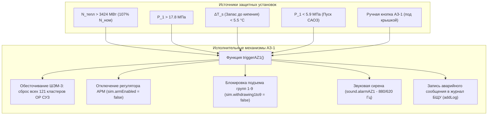
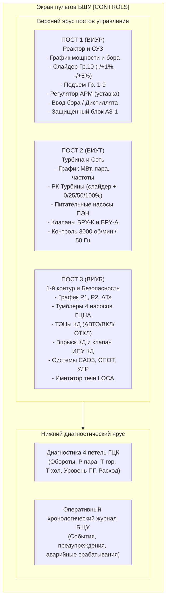

# ТЕХНИЧЕСКАЯ АРХИТЕКТУРНАЯ КАРТА ПРОЕКТА (PROJECT_MAP.md)
## Цифровой двойник и инженерный тренажер энергоблока ВВЭР-1200 (Проект В-392М / Поколение III+)

> **Статус документа:** Официальный архитектурный аудит (Lead Systems Architect Audit)  
> **Целевой файл аудита:** [`index.html`](file:///c:/Users/User/Desktop/сайт%20атомной%20инженирии/index.html) (Объем: 7 675 строк, ~351 КБ)  
> **Режим доступа к кодовой базе:** READ-ONLY (модификация исходного кода строго запрещена)

---

## 1. Архитектурный стек и глобальная топология монолита

### 1.1. Обзор монолитной архитектуры
Проект представляет собой **высокоинтегрированный одностраничный автономный Web-монолит (Zero-Build Single-File Architecture)**, объединяющий SCADA-интерфейс блочного щита управления (БЩУ), физико-математическую модель ядерного реактора в реальном времени (60 FPS), 2D Canvas-мнемосхемы технологических контуров и 3D-сцену главного циркуляционного контура на WebGL.

#### Внешние зависимости и библиотеки:
1. **Three.js (Release r128)**:
   - Подключение: `` ([строки 8–9](file:///c:/Users/User/Desktop/сайт%20атомной%20инженирии/index.html#L8-L9)).
   - Роль: 3D-рендеринг оборудования гермооболочки реакторного отделения (корпус ВВЭР-1200, активная зона с Черенковским свечением, 4 петли ГЦК, 4 парогенератора ПГВ-1000МКП, 4 насоса ГЦНА-1391, компенсатор давления, гидроемкости САОЗ, теплообменники СПОТ, ловушка расплава УЛР).
   - Fallback: Предусмотрен флаг `window.__threeLoadError` и обработка потери контекста WebGL (`webglcontextlost` / `webglcontextrestored`).
2. **Web Audio API (Native Native Browser API)**:
   - Синтез процедурного звука в реальном времени ([строки 1969–2082](file:///c:/Users/User/Desktop/сайт%20атомной%20инженирии/index.html#L1969-L2082)): гул насосов и турбины (Sawtooth осциллятор 50 Гц + Lowpass фильтр 140 Гц), белый шум дросселирования пара БРУ-К/БРУ-А/ИПУ КД (BufferSource + Bandpass 1100 Гц), аварийный двухтональный зуммер АЗ-1 (880 Гц / 620 Гц).
3. **Google Fonts / Fallbacks**:
   - UI шрифты: `'Inter', 'Segoe UI', -apple-system, Roboto, sans-serif`.
   - Моноширинные SCADA-шрифты телеметрии: `'JetBrains Mono', 'Consolas', 'Courier New', monospace`.

---

### 1.2. Топология файла с точными диапазонами строк (Line Ranges)

```mermaid
graph TD
    A["index.html (7675 строк)"] --> B["Стилизация CSS: L10–L1249"]
    A --> C["Разметка DOM / SCADA: L1250–L1812"]
    A --> D["Движок JS: L1813–L7672"]
    
    B --> B1[":root & Переменные SCADA: L11–L59"]
    B --> B2["Reset & Базовые правила: L60–L90"]
    B --> B3["SCADA-шапка & Телеметрия: L91–L366"]
    B --> B4["Холст 2D/3D & HUD: L367–L680"]
    B --> B5["Пульт БЩУ [CONTROLS]: L681–L1230"]
    B --> B6["Media Queries: L1231–L1248"]

    C --> C1["Шапка & Вкладки: L1256–L1323"]
    C --> C2["Полоса KPI телеметрии: L1324–L1360"]
    C --> C3["Viewport Холста & Three.js: L1361–L1475"]
    C --> C4["3 Поста БЩУ & Петли & Журнал: L1476–L1809"]

    D --> D1["Геометрия 163 ТВС: L1815–L1866"]
    D --> D2["Состояние sim: L1867–L1947"]
    D --> D3["Web Audio Движок: L1969–L2082"]
    D --> D4["Физико-математическое ядро: L2083–L2410"]
    D --> D5["Мини-графики постов: L2411–L2548"]
    D --> D6["2D Рендереры SCADA Canvas: L2549–L4861"]
    D --> D7["3D PBR Сцена Three.js: L4862–L7114"]
    D --> D8["Диспетчер Canvas: L7115–L7171"]
    D --> D9["Синхронизация DOM: L7172–L7252"]
    D --> D10["Обработчики UI: L7253–L7455"]
    D --> D11["Сценарии & Главный цикл: L7456–L7671"]
```

#### Детальная таблица диапазонов строк (Line Ranges):

| Блок | Диапазон строк | Назначение и ключевые компоненты |
|---|---|---|
| **HTML Header & External Libs** | [L1 – L9](file:///c:/Users/User/Desktop/сайт%20атомной%20инженирии/index.html#L1-L9) | Мета-теги, Title, асинхронная загрузка Three.js r128 CDN с обработчиком ошибок |
| **Стилизация: Дизайн-система SCADA (Светлая тема)** | [L11 – L59](file:///c:/Users/User/Desktop/сайт%20атомной%20инженирии/index.html#L11-L59) | Внедрение светлой индустриальной темы БЩУ (IAEA SCADA Standard): переменные `:root`, стальной фон каркаса `--bg-deep: #cbd5e1`, приборные стойки `--bg-panel: #e2e8f0`, экраны датчиков `--bg-card: #ffffff`, границы `--border-dim: #94a3b8`, текст `--text-main: #0f172a`, контуры `--cold-water: #1d4ed8`, `--hot-coolant: #dc2626`, сигнальные статусы `--green`, `--amber`, `--red` |
| **Стилизация: Базовый сброс и каркас** | [L60 – L90](file:///c:/Users/User/Desktop/сайт%20атомной%20инженирии/index.html#L60-L90) | Box-sizing, 100vw/100vh lock, сброс свечений и теней (`box-shadow: none !important`), трехстрочная сетка `.iaea-shell` (54px / 40px / flex) |
| **Стилизация: Вкладки режимов и панель KPI** | [L91 – L366](file:///c:/Users/User/Desktop/сайт%20атомной%20инженирии/index.html#L91-L366) | Верхняя панель `.topbar` (#e2e8f0), контрастные вкладки `.view-tab` (активная: #cbd5e1, рамка 2px solid #334155), панель телеметрии `.telemetry-bar` (#f1f5f9), блоки параметров `.kpi-box` (#ffffff, рамка #cbd5e1), селекторы сценариев и шкала времени |
| **Стилизация: Вьюпорт, Холст, HUD** | [L367 – L503](file:///c:/Users/User/Desktop/сайт%20атомной%20инженирии/index.html#L367-L503) | `.viewport-screen`, полупрозрачный SCADA-тулбар `.canvas-overlay-top`, белые кнопки подрежимов `.sub-view-btn`, лента технологических этапов `.stages-ribbon` [01]–[06] |
| **Стилизация: Three.js контейнер и подсказки** | [L504 – L680](file:///c:/Users/User/Desktop/сайт%20атомной%20инженирии/index.html#L504-L680) | Контейнер `#threeContainer` (контрастный дисплей #0f172a с контуром 2px solid #475569), оверлей-тулбар `.three-toolbar`, подсказка `.canvas-tooltip`, нижний HUD баланса реактивности `.canvas-hud-bottom` (#e2e8f0, рамка #94a3b8, четкие угольно-черные цифры pcm) |
| **Стилизация: Пульт БЩУ [CONTROLS]** | [L681 – L984](file:///c:/Users/User/Desktop/сайт%20атомной%20инженирии/index.html#L681-L984) | Светло-серые стойки 3 постов `.control-post` (#eef2f6), заголовки `.post-header`, контейнеры мини-графиков `.post-chart-box`, ползунки, кнопки-переключатели `.btn-ctrl` с индикацией контакта |
| **Стилизация: Блок АЗ-1, петли и журнал** | [L985 – L1230](file:///c:/Users/User/Desktop/сайт%20атомной%20инженирии/index.html#L985-L1230) | Защищенный блок кнопки АЗ-1 `.az1-container` с откидной крышкой `.az1-cover-shield`, карточки 4 петель `.loop-card`, консоль журнала `.event-log`, переопределения SCADA-цветов |
| **Стилизация: Адаптивность (Media Queries)** | [L1231 – L1248](file:///c:/Users/User/Desktop/сайт%20атомной%20инженирии/index.html#L1231-L1248) | `@media (max-width: 1180px)`: перестроение постов БЩУ в 1 колонку, адаптация сетки петель |
| **Разметка: Шапка и навигация** | [L1256 – L1323](file:///c:/Users/User/Desktop/сайт%20атомной%20инженирии/index.html#L1256-L1323) | Логотип атома, 4 таба `[СИСТЕМЫ]`, `[УПРАВЛЕНИЕ]`, `[АКТИВНАЯ ЗОНА]`, `[3D МОДЕЛЬ]`, переключатель режима обучения, селектор сценариев, кнопки скорости времени, звук |
| **Разметка: Телеметрическая полоса** | [L1324 – L1360](file:///c:/Users/User/Desktop/сайт%20атомной%20инженирии/index.html#L1324-L1360) | Бейдж статуса энергоблока, 6 боксов KPI (Nтепл, Nэлектр, P1, ΔTs, Бор, Реактивность), частота сети и P2 ГПК |
| **Разметка: Холст и 3D-контейнер** | [L1361 – L1475](file:///c:/Users/User/Desktop/сайт%20атомной%20инженирии/index.html#L1361-L1475) | `<canvas id="simCanvas">`, тулбар подрежимов (Панорама, 4 петли, Разрез), лента [01]–[06], `#threeContainer`, тулбар 3D-камер, тултип, HUD реактивности |
| **Разметка: Пульт БЩУ (3 поста)** | [L1476 – L1731](file:///c:/Users/User/Desktop/сайт%20атомной%20инженирии/index.html#L1476-L1731) | Пост 1 (ВИУР: СУЗ, АРМ, Бор, АЗ-1), Пост 2 (ВИУТ: РК турбины, ПЭН, БРУ-К/А), Пост 3 (ВИУБ: ГЦНА 1..4, КД, САОЗ, СПОТ, УЛР) |
| **Разметка: Консоль петель и журнал** | [L1732 – L1809](file:///c:/Users/User/Desktop/сайт%20атомной%20инженирии/index.html#L1732-L1809) | 4 карточки параметров петель (`#loopCard0`..`#loopCard3`), оперативный журнал `#eventLog` с кнопкой очистки |
| **JS: 1. Геометрия 163 ТВС (Решетка ВВЭР)** | [L1815 – L1866](file:///c:/Users/User/Desktop/сайт%20атомной%20инженирии/index.html#L1815-L1866) | Генератор гексагональной решетки $q^2 + r^2 + qr \le 43$ (163 ТВС-2М), $distSq \le 31$ (121 кластер ОР СУЗ, 10 групп), зоны обогащения |
| **JS: 2. Реестр глобального состояния `sim`** | [L1867 – L1947](file:///c:/Users/User/Desktop/сайт%20атомной%20инженирии/index.html#L1867-L1947) | Объект `const sim`: нейтронная физика, теплогидравлика 1-го и 2-го контуров, уставки безопасности, аварийные флаги |
| **JS: 3. Журнал событий БЩУ** | [L1948 – L1968](file:///c:/Users/User/Desktop/сайт%20атомной%20инженирии/index.html#L1948-L1968) | Функция `addLog(message, type)`: временные метки, цветовая SCADA-индикация, автоскролл |
| **JS: 4. Звуковой движок Web Audio** | [L1969 – L2082](file:///c:/Users/User/Desktop/сайт%20атомной%20инженирии/index.html#L1969-L2082) | Объект `const sound`: процедурный гул насосов, пар БРУ-К/А, сирена АЗ-1 (880/620 Гц), клики тумблеров |
| **JS: 5. Физико-математическое ядро** | [L2083 – L2410](file:///c:/Users/User/Desktop/сайт%20атомной%20инженирии/index.html#L2083-L2410) | `calcSaturationTempC`, `triggerAZ1`, `stepPhysics(dtReal)`, теплобаланс 4 петель ГЦК, уставки АЗ-1, словарь понятных терминов `plainExplanations` |
| **JS: 6. Мини-графики постов** | [L2411 – L2548](file:///c:/Users/User/Desktop/сайт%20атомной%20инженирии/index.html#L2411-L2548) | Буфер истории `chartHistory` (180 точек), дискретизация `sampleCharts`, векторная отрисовка `drawMultiChart`, SCADA палитра |
| **JS: 7A. Ядро 2D Canvas и камера** | [L2549 – L3076](file:///c:/Users/User/Desktop/сайт%20атомной%20инженирии/index.html#L2549-L3076) | `cam` (pan/zoom/drag), трансформация координат `worldX/worldY`, хит-тест `checkHotspotHover`, частицы потоков |
| **JS: 7B. Панорамная мнемосхема SCADA** | [L3077 – L3769](file:///c:/Users/User/Desktop/сайт%20атомной%20инженирии/index.html#L3077-L3769) | `renderPanoramicSystemsView()`: сквозная схема Реактор → КД → ПГВ → ГПК → Турбина → Конденсатор → ПЭН |
| **JS: 7C. Разрез гермооболочки В-392М** | [L3770 – L4431](file:///c:/Users/User/Desktop/сайт%20атомной%20инженирии/index.html#L3770-L4431) | `renderCrossSectionView()`: вертикальный разрез здания реактора, шахты, УЛР, ПГВ, машинного зала |
| **JS: 7D. Вид сверху: 4 петли ГЦК** | [L4432 – L4646](file:///c:/Users/User/Desktop/сайт%20атомной%20инженирии/index.html#L4432-L4646) | `renderFourLoopsPlanView()`: радиальная 4-петлевая компоновка, гидродинамика петель |
| **JS: 7E. Картограмма активной зоны** | [L4647 – L4861](file:///c:/Users/User/Desktop/сайт%20атомной%20инженирии/index.html#L4647-L4861) | `renderCoreCartogramView()`: 163 шестигранные ТВС, поле $K_q$, паспорт кассеты, 12 высотных слоев $K_z$, диаграмма погружения стержней |
| **JS: 7F. Интерактивная 3D-сцена Three.js (PBR)** | [L4862 – L7114](file:///c:/Users/User/Desktop/сайт%20атомной%20инженирии/index.html#L4862-L7114) | Интеграция PBR-сцены ВВЭР-1200: 163 ТВС с Черенковским свечением, 4 горизонтальных ПГВ-1000МКП, ГЦНА-1391 с вращающимися крыльчатками, КД с дыхательной линией, гидроемкости САОЗ, УЛР, Exploded view (взрыв-схема) и X-Ray режим прозрачности, тепловой градиент ниток Ду-850, анимация потоков частиц |
| **JS: 7G. Диспетчер холста Canvas** | [L7115 – L7171](file:///c:/Users/User/Desktop/сайт%20атомной%20инженирии/index.html#L7115-L7171) | `renderCanvas(dtReal)`: сетка, масштабирование под экран, вызов активного представления |
| **JS: 8. Синхронизация DOM-телеметрии** | [L7172 – L7252](file:///c:/Users/User/Desktop/сайт%20атомной%20инженирии/index.html#L7172-L7252) | `updateDOMTelemetry()`: обновление текстовых значений, цветных индикаторов и карточек 4 петель |
| **JS: 9. Обработчики управления UI** | [L7253 – L7455](file:///c:/Users/User/Desktop/сайт%20атомной%20инженирии/index.html#L7253-L7455) | Слайдеры СУЗ, турбины, ПЭН; тумблеры ГЦН, САОЗ, СПОТ, УЛР; защитный замок кнопки АЗ-1 |
| **JS: 10. Предустановленные сценарии** | [L7456 – L7649](file:///c:/Users/User/Desktop/сайт%20атомной%20инженирии/index.html#L7456-L7649) | `applyScenario(key)`: 1 — Номинал 100%, 2 — Выход на МКУ, 3 — Йодная яма, 4 — Обесточивание (Blackout), 5 — Течь 1 контура (LOCA) |
| **JS: 11. Главный цикл симуляции** | [L7650 – L7671](file:///c:/Users/User/Desktop/сайт%20атомной%20инженирии/index.html#L7650-L7671) | `mainLoop(now)`: 60 FPS `requestAnimationFrame`, расчет шага физики, дискретизация графиков, рендер, `window.onload` |

---

## 2. Реестр глобального состояния (State Machine & Physics Model)

Центральным хранилищем данных симулятора является глобальный синглтон `sim` ([L1868–L1947](file:///c:/Users/User/Desktop/сайт%20атомной%20инженирии/index.html#L1868-L1947)), дополняемый динамическими параметрами режима обучения на [L2355–L2410](file:///c:/Users/User/Desktop/сайт%20атомной%20инженирии/index.html#L2355-L2410).

### 2.1. Таблица переменных симулятора

| Категория | Переменная в коде | Тип | Ед. изм. | Номинал | Физический смысл и расчетные зависимости |
|---|---|---|---|---|---|
| **Нейтронная физика** | `sim.thermalPowerMW` | `float` | МВт | `3200.0` | Тепловая мощность активной зоны: $N_{\text{th}} = N_{\text{fiss}} + N_{\text{decay}}$ |
| | `sim.neutronFlux` | `float` | отн. ед. | `1.0` | Плотность нейтронного потока (квазистационарное приближение) |
| | `sim.precursors` | `float` | отн. ед. | `1.0` | Концентрация ядер-предшественников запаздывающих нейтронов ($\beta = 0.0065, \lambda = 0.085\,\text{c}^{-1}$) |
| | `sim.decayHeatMW` | `float` | МВт | `195.0` | Тепловыделение осколков деления ($\sim 6.1\%$ от номинала с инерционным спадом) |
| | `sim.group10Pos` | `float` | % | `80.0` | Положение регулирующей группы №10 ОР СУЗ (13 кластеров, вес 9.5 pcm/%) |
| | `sim.groups1to9Pos` | `float` | % | `100.0` | Положение аварийно-компенсирующих групп №1–9 (108 кластеров, вес 65.0 pcm/%) |
| | `sim.armEnabled` | `boolean` | — | `true` | Флаг активности Автоматического регулятора мощности (АРМ) |
| | `sim.armTargetMW` | `float` | МВт | `3200.0` | Целевая уставка мощности для регулятора АРМ |
| | `sim.boronConc` | `float` | г/кг | `6.20` | Концентрация борной кислоты $H_3BO_3$ ($\alpha_B = -85\,\text{pcm}/(\text{г/кг})$) |
| | `sim.boronMode` | `integer` | — | `0` | Режим СБР: `-1` (ввод дистиллята), `0` (нейтрально), `+1` (концентрат 40 г/кг) |
| | `sim.iodine135` | `float` | отн. ед. | `1.0` | Относительная концентрация Йода-135 (предшественник Ксенона-135) |
| | `sim.xenon135` | `float` | отн. ед. | `1.0` | Относительная концентрация Ксенона-135 (отравление зоны / йодная яма) |
| | `sim.rhoRods` | `float` | pcm | `0.0` | Реактивность, вносимая стержнями СУЗ: $(G_{10}-80)\cdot 9.5 + (G_{1-9}-100)\cdot 65$ |
| | `sim.rhoBoron` | `float` | pcm | `0.0` | Реактивность борного регулирования: $-(C_{\text{boron}} - 6.20)\cdot 85$ |
| | `sim.rhoDoppler` | `float` | pcm | `0.0` | Допплеровский эффект топлива $UO_2$: $-(T_{\text{fuel}} - 680)\cdot 2.8$ |
| | `sim.rhoModerator` | `float` | pcm | `0.0` | Эффект замедлителя: $-(T_{\text{avg}} - 313.55)\cdot 34.0 - \text{voidPenalty}$ |
| | `sim.rhoXenon` | `float` | pcm | `0.0` | Реактивность стационарного и нестационарного отравления Ксеноном-135 |
| | `sim.rhoTotal` | `float` | pcm | `0.0` | Полный баланс реактивности (ограничен диапазоном $-8000 \dots +580\,\text{pcm}$) |
| | `sim.kqMax` | `float` | отн. ед. | `1.32` | Максимальный коэффициент радиальной неравномерности энерговыделения |
| **Теплогидравлика 1-го контура** | `sim.fuelTempC` | `float` | °C | `680.0` | Средняя температура таблеток диоксида урана в твэлах |
| | `sim.coreInletTempC` | `float` | °C | `298.2` | Температура теплоносителя на входе в реактор ($T_{\text{вх}}$) |
| | `sim.coreOutletTempC` | `float` | °C | `328.9` | Температура теплоносителя на выходе из реактора ($T_{\text{вых}}$) |
| | `sim.primaryPressureMPa`| `float` | МПа | `16.20` | Давление теплоносителя 1-го контура $P_1$ (уставка поддержания КД) |
| | `sim.pressurizerLevelM` | `float` | м | `8.40` | Уровень теплоносителя в компенсаторе давления (номинал 8.4 м) |
| | `sim.heatersMode` | `string` | — | `'AUTO'` | Режим ТЭНов КД (`'AUTO'`, `'ON'`, `'OFF'`) |
| | `sim.heatersPowerKW` | `integer` | кВт | `900` | Текущая электрическая мощность групп ТЭН КД ($0 \dots 2700\,\text{кВт}$) |
| | `sim.sprayActive` | `boolean` | — | `false` | Подача холодного теплоносителя на впрыск в паровую подушку КД |
| | `sim.ipuKdOpen` | `boolean` | — | `false` | Положение импульсно-предохранительного устройства ИПУ КД |
| | `sim.subcoolingMarginC` | `float` | °C | `19.5` | Запас теплоносителя горячих ниток до температуры насыщения $\Delta T_s$ |
| | `sim.loops[0..3]` | `array` | — | 4 петли | Параметры петель: `pumpOn`, `rpm` (1000), `flowPct` (100%), `tHot`, `tCold`, `sgLevelM`, `sgPressMPa` |
| **Параметры 2-го контура** | `sim.steamHeaderPressMPa`| `float`| МПа | `7.00` | Давление свежего насыщенного пара в главном паровом коллекторе (ГПК) $P_2$ |
| | `sim.steamTempC` | `float` | °C | `285.8` | Температура насыщения пара во 2-м контуре: $179.88 \cdot P_2^{0.2378}$ |
| | `sim.feedwaterFlowPct` | `float` | % | `100.0` | Производительность питательных электронасосов (ПЭН) |
| | `sim.turbineValvePct` | `float` | % | `100.0` | Степень открытия регулирующих клапанов (РК) турбины |
| | `sim.turbineRpm` | `float` | об/мин | `3000.0` | Частота вращения валопровода турбоагрегата (50 Гц) |
| | `sim.electricalPowerMW` | `float` | МВт | `1200.0` | Электрическая мощность генератора ТЗВ-1200-2 на шинах распредустройства |
| | `sim.bruKOpen` | `boolean` | — | `false` | Сброс пара через БРУ-К в конденсатор турбины (до 650 МВт) |
| | `sim.bruAOpen` | `boolean` | — | `false` | Аварийный сброс чистого пара через БРУ-А в атмосферу (до 480 МВт) |
| **Системы безопасности** | `sim.az1Tripped` | `boolean` | — | `false` | Главный триггер срабатывания Аварийной защиты 1-го рода (АЗ-1) |
| | `sim.az1CoverOpen` | `boolean` | — | `false` | Состояние механической защитной крышки кнопки АЗ-1 на щите ВИУР |
| | `sim.saozActive` | `boolean` | — | `false` | Подача борированной воды из гидроемкостей САОЗ второй ступени ГЕ-1..3 |
| | `sim.saozWaterPct` | `float` | % | `100.0` | Остаточный запас раствора борной кислоты (16 г/кг) в емкостях САОЗ |
| | `sim.spotActive` | `boolean` | — | `false` | Состояние шиберов Системы пассивного отвода тепла через купол (СПОТ) |
| | `sim.ulrCoolingActive` | `boolean` | — | `false` | Подача охлаждающей воды в шахту Устройства локализации расплава (УЛР) |
| | `sim.primaryLeakActive` | `boolean` | — | `false` | Имитация разгерметизации (малой течи LOCA) первого контура |

---

### 2.2. Математические модели и формулы физического ядра

1. **Точечная кинетика нейтронов с мгновенным скачком** ([L2182–L2193](file:///c:/Users/User/Desktop/сайт%20атомной%20инженирии/index.html#L2182-L2193)):
   $$\Phi_{\text{target}} = C \cdot \frac{\beta_{\text{eff}}}{\beta_{\text{eff}} - \rho}, \quad \frac{dC}{dt} = \lambda (\Phi - C), \quad \beta_{\text{eff}} = 0.0065, \quad \lambda = 0.085\,\text{с}^{-1}$$
2. **Температура насыщения воды** ([L2085–L2088](file:///c:/Users/User/Desktop/сайт%20атомной%20инженирии/index.html#L2085-L2088)):
   $$T_{\text{sat}}(P) = 179.88 \cdot P^{0.2378} \quad [P \text{ в МПа}, T \text{ в } ^\circ\text{C}]$$
3. **Естественная циркуляция при выбеге ГЦН** ([L2208–L2212](file:///c:/Users/User/Desktop/сайт%20атомной%20инженирии/index.html#L2208-L2212)):
   $$G_{\text{nat}} = 6.8\% + 2.2\% \cdot \left(\frac{T_{\text{вых}} - T_{\text{вх}}}{30.7^\circ\text{C}}\right) \approx 7.5\% \dots 9.0\%$$
4. **Теплопередача 1-го во 2-й контур через трубные пучки ПГВ-1000МКП** ([L2234](file:///c:/Users/User/Desktop/сайт%20атомной%20инженирии/index.html#L2234)):
   $$Q_{1\to 2} = (T_{\text{avg}} - T_{\text{steam}}) \cdot \left(\frac{3200}{27.75}\right) \cdot (G_{\text{flow}})^{0.35}$$

---

### 2.3. Алгоритмы и аварийные уставки АЗ-1

Срабатывание защит обрабатывается в функции `triggerAZ1(reason)` ([L2090–L2099](file:///c:/Users/User/Desktop/сайт%20атомной%20инженирии/index.html#L2090-L2099)) и блоке автоматических блокировок ([L2320–L2330](file:///c:/Users/User/Desktop/сайт%20атомной%20инженирии/index.html#L2320-L2330)):

---

## 3. Карта компонентов интерфейса (DOM & SCADA Panels)

### 3.1. Верхняя панель и статусная лента этапов [01]–[06]
- **Навигационная шапка (`.topbar`)** ([L1256–L1323](file:///c:/Users/User/Desktop/сайт%20атомной%20инженирии/index.html#L1256-L1323)):
  - Брендинг проекта: логотип атома, наименование ВВЭР-1200 / проект В-392М.
  - Табы переключения экранов: `[SYSTEMS]`, `[CONTROLS]`, `[CORE]`, `[3D TWIN]`.
  - Модули оперативного управления: кнопка «Режим обучения» (`#btnEduMode`), селектор пресетов сценариев (`#scenarioSelect`), кнопки масштаба времени (`0x`, `1x`, `2x`, `5x`, `10x`), тумблер Web Audio (`#btnAudio`).
- **Телеметрическая полоса (`.telemetry-bar`)** ([L1324–L1360](file:///c:/Users/User/Desktop/сайт%20атомной%20инженирии/index.html#L1324-L1360)):
  - Бейдж технологического состояния блока (`#modeBadge`): номинал, энергопуск, МКУ, СПОТ/ЕЦ, САОЗ, АЗ-1.
  - 6 KPI-блоков: Тепловая мощность $N_{\text{th}}$, Электрическая мощность $N_{\text{el}}$, Давление 1 контура $P_1$, Запас до кипения $\Delta T_s$, Концентрация бора $C_B$, Реактивность $\rho$.
  - Параметры сети и 2-го контура: Частота сети (Гц), Давление в ГПК $P_2$ (МПа).
- **Лента технологических этапов [01]–[06] (`#stagesRibbon`)** ([L1380–L1422](file:///c:/Users/User/Desktop/сайт%20атомной%20инженирии/index.html#L1380-L1422)):
  - `[01]` РЕАКТОР ВВЭР-1200 И ЗАЩИТА (активная зона, твэлы, стержни СУЗ, САОЗ, СПОТ).
  - `[02]` КОМПЕНСАТОР ДАВЛ. (КД) (паровая подушка, ТЭНы, впрыск, клапаны ИПУ КД).
  - `[03]` ПАРОГЕНЕРАТОРЫ ПГВ И ГЦНА (теплообменные трубки, коллекторы, насосы Ду850).
  - `[04]` ГПК И КЛАПАНЫ БРУ-К/А (свежий пар, дросселирование, редуцирование).
  - `[05]` ТУРБИНА И ГЕНЕРАТОР (цилиндры ЦВД/ЦНД, РК турбины, генератор ТЗВ-1200-2).
  - `[06]` КОНДЕНСАТОР И НАСОСЫ ПЭН (фазовый переход, деаэратор, замкнутый контур питания).

---

### 3.2. Холст технологических мнемосхем и 3D-вьюпорт
Рабочая область объединяет три графических движка в рамках `#viewportScreen`:

1. **2D Canvas Мнемосхема (`#simCanvas`)**:
   - **Подрежим «Панорама»** (`renderPanoramicSystemsView`, [L3077–L3769](file:///c:/Users/User/Desktop/сайт%20атомной%20инженирии/index.html#L3077-L3769)): Горизонтальная структурная схема энергоблока от защитной оболочки до градирен. Содержит интерактивные клапаны и насосы с прямым кликабельным управлением (`drawClickableArmature`).
   - **Подрежим «Схема 4 петель ГЦК»** (`renderFourLoopsPlanView`, [L4432–L4646](file:///c:/Users/User/Desktop/сайт%20атомной%20инженирии/index.html#L4432-L4646)): Вид сверху на реакторную установку с радиальным расположением 4 парогенераторов и 4 насосов ГЦНА-1391.
   - **Подрежим «Разрез В-392М»** (`renderCrossSectionView`, [L3770–L4431](file:///c:/Users/User/Desktop/сайт%20атомной%20инженирии/index.html#L3770-L4431)): Вертикальный разрез двойной защитной оболочки, реакторного зала, шахты реактора, бассейна выдержки и смежного машинного зала.
   - **Режим [CORE]** (`renderCoreCartogramView`, [L4647–L4861](file:///c:/Users/User/Desktop/сайт%20атомной%20инженирии/index.html#L4647-L4861)): Полноэкранная картограмма активной зоны на 163 кассеты ТВС-2М. Поддерживает выбор любой кассеты кликом, отображение радиального поля $K_q$, кампании, выгорания (МВт·сут/кг) и высотного 12-слойного профиля $K_z$.
2. **3D WebGL Вьюпорт Three.js (`#threeContainer`)** ([L4862–L7114](file:///c:/Users/User/Desktop/сайт%20атомной%20инженирии/index.html#L4862-L7114)):
   - Оснащен тулбаром пресетов камеры: «Общий вид», «Разрез реактора», «Вид сверху 4 петли», «УЛР и днище», кнопкой включения автовращения камеры.
   - 3D-анимация: тепловой цвет труб в зависимости от $T_{\text{hot}}/T_{\text{cold}}$, физическое опускание/подъем стержней СУЗ в активную зону, вращение крыльчаток насосов со скоростью, пропорциональной RPM, динамический столб воды в КД и частицы струи пара ИПУ КД.

---

### 3.3. Модульный пульт управления БЩУ (`#controlsScreen`)
Пульт организован по трехпостовому принципу реальных АЭС с водо-водяными реакторами:

---

## 4. Карта рисков и узких мест (Tech Debt & Bottlenecks)

### 4.1. Участки с жестко зашитыми абсолютными координатами (Hardcoded Canvas Coordinates)
Отрисовка технологических мнемосхем в `renderPanoramicSystemsView`, `renderCrossSectionView` и `renderCoreCartogramView` опирается на фиксированные виртуальные разрешения сцены ($1360 \times 720$ и $1160 \times 720$).

#### Выявленные критические точки риска:
1. **Текстовые вызовы `ctx.fillText` в Панорамной мнемосхеме ([L3077–L3769](file:///c:/Users/User/Desktop/сайт%20атомной%20инженирии/index.html#L3077-L3769))**:
   - `L3267–L3287`: Надписи внутри корпуса реактора (`rxMidX, rxY + 25`, `rxY + 43`, `rxY + 61`, `rxY + 79`, `rxY + 95`). При ширине реактора `rxW = 108px` строки текста длиннее 12 символов (например, при локализации на другие языки или изменении масштаба шрифта) выходят за пределы контура корпуса.
   - `L3312–L3314`: Координаты емкостей САОЗ `x=39, y=253` и уровня `x=47, y=310` зашиты абсолютными числами без привязки к габаритам родительского прямоугольника.
   - `L3595–L3635`: Блок ГПК (`gpkX = 675, gpkY = 172, gpkW = 130`). Арматура БРУ-К и БРУ-А привязана сдвигами `+18` и `+78`, что исключает добавление дополнительных линий пара без ручного пересчета всех смещений.
2. **Паспорт кассеты ТВС в картограмме ([L4740–L4860](file:///c:/Users/User/Desktop/сайт%20атомной%20инженирии/index.html#L4740-L4860))**:
   - Паспорт расположен в координатах `cardX = 720, cardY = 58, cardW = 415, cardH = 595`.
   - Центр активной зоны зафиксирован на `centerX = 395, centerY = 370`. Радиус описанной окружности активной зоны составляет $\sim 330\,\text{px}$.
   - **Риск коллизии:** При соотношении сторон экрана отличного от 16:9 (например, 4:3 или при открытых DevTools) горизонтальный зум или сдвиг влево приводит к визуальному наложению правых периферийных ТВС на паспорт кассеты.
3. **Хит-зоны интерактивной арматуры (`activeHotspots`)**:
   - Прямоугольники кликов и ховеров (`drawClickableArmature`) рассчитываются на основе фиксированных размеров ($w=40, h=30$). Если в будущем изменить масштаб узла, хит-бокс разойдется с отрисованным векторным изображением вентиля.

---

### 4.2. Узкие места производительности (FPS Drops & Memory Leaks)

#### 1. Forced Synchronous Layout / Layout Thrashing в цикле 60 FPS
- **Локация:** [L7653–L7664](file:///c:/Users/User/Desktop/сайт%20атомной%20инженирии/index.html#L7653-L7664) (`mainLoop`) $\to$ [L7172](file:///c:/Users/User/Desktop/сайт%20атомной%20инженирии/index.html#L7172) (`updateDOMTelemetry`) $\to$ [L7116](file:///c:/Users/User/Desktop/сайт%20атомной%20инженирии/index.html#L7116) (`renderCanvas`).
- **Механизм деградации:** В функции `updateDOMTelemetry` скрипт изменяет свойства DOM более чем 30 элементов (вызовы `.textContent`, `.classList.toggle`). Сразу после этого в функции `renderCanvas` вызывается `canvasContainer.getBoundingClientRect()`. Браузер вынужден прерывать JavaScript-поток и выполнять принудительный синхронный пересчет геометрии (Reflow/Layout) на **каждом кадре**.
- **Последствия:** Просадки FPS до 35–45 к/с на мониторах 120/144 Гц и перегрев CPU на мобильных процессорах.

#### 2. Регулярные аллокации памяти в цикле анимации (GC Pressure)
- **Локация:** [L3078](file:///c:/Users/User/Desktop/сайт%20атомной%20инженирии/index.html#L3078), [L3771](file:///c:/Users/User/Desktop/сайт%20атомной%20инженирии/index.html#L3771), [L4433](file:///c:/Users/User/Desktop/сайт%20атомной%20инженирии/index.html#L4433), [L4648](file:///c:/Users/User/Desktop/сайт%20атомной%20инженирии/index.html#L4648).
- **Механизм:** Массив `activeHotspots` обнуляется через переприсваивание `activeHotspots = []` на каждом кадре. В процессе рендеринга создается от 15 до 30 новых JS-объектов с анонимными функциями `telemetry: () => ...` и `onClick: () => ...`.
- **Последствия:** Создание десятков тысяч короткоживущих объектов в секунду вызывает периодические микрофризы сборщика мусора (V8 Minor GC Scavenges).

#### 3. Сдвиг массивов в `pushCap` (`Array.prototype.shift`)
- **Локация:** [L2444–L2447](file:///c:/Users/User/Desktop/сайт%20атомной%20инженирии/index.html#L2444-L2447).
- **Механизм:** Метод `arr.shift()` на массиве из 180 элементов для 10 графиков каждые 140 мс выполняет побайтное смещение содержимого массива в памяти ($O(N)$). При увеличении буфера истории до 1000+ точек это приведет к заметным задержкам.

#### 4. Неосвобождаемые узлы в Web Audio API
- **Локация:** [L2037–L2049](file:///c:/Users/User/Desktop/сайт%20атомной%20инженирии/index.html#L2037-L2049) (`sound.click`).
- **Механизм:** На каждый клик создаются новые узлы `OscillatorNode` и `GainNode`. Метод `stop()` вызывается, но явный `disconnect()` отсутствует. В старых версиях WebKit/Chromium такие узлы могут задерживаться в аудио-графе.

---

### 4.3. Рекомендации по безопасной модификации и рефакторингу

Для будущих доработок без нарушения целостности симулятора рекомендуется придерживаться следующих правил:

1. **Кеширование геометрии контейнера:**
   - Вынести расчет `canvasContainer.getBoundingClientRect()` из `renderCanvas` в отдельный обработчик `window.addEventListener('resize')` и инициализацию. Внутри кадра использовать кешированные значения `cachedWidth` / `cachedHeight`.
2. **Переиспользование пула хотспотов (Object Pooling):**
   - Вместо создания массива `activeHotspots = []` на каждом кадре объявить статичный массив объектов и актуализировать лишь флаги доступности (`hotspot.active = true/false`) и значения телеметрии.
3. **Безопасная калибровка физических параметров:**
   - Все коэффициенты реактивности сосредоточены в блоке [L2155–L2180](file:///c:/Users/User/Desktop/сайт%20атомной%20инженирии/index.html#L2155-L2180). При изменении коэффициентов (например, $\alpha_D$ или $\alpha_B$) необходимо синхронно корректировать номинальную уставку борной кислоты в сценарии `nominal` ([L7485](file:///c:/Users/User/Desktop/сайт%20атомной%20инженирии/index.html#L7485)), иначе при старте симулятор сразу уйдет в нескомпенсированный разгон или самозаглушение.
4. **Модуляризация без сборщиков (ES Modules):**
   - Разделение монолита может быть выполнено без обязательного внедрения Webpack/Vite через нативные ES-модули браузера (`<script type="module">`):
     - `physics/kinetics.js` — кинетика и уравнения состояния;
     - `physics/hydraulics.js` — контуры, давления, парогенераторы;
     - `scada/canvas-views.js` — 2D мнемосхемы;
     - `three/twin-scene.js` — 3D окружение;
     - `ui/controls-desk.js` — обработчики кнопок и слайдеров.

---
*Документ составлен и утвержден в качестве официального технического паспорта архитектуры проекта ВВЭР-1200 Digital Twin.*
